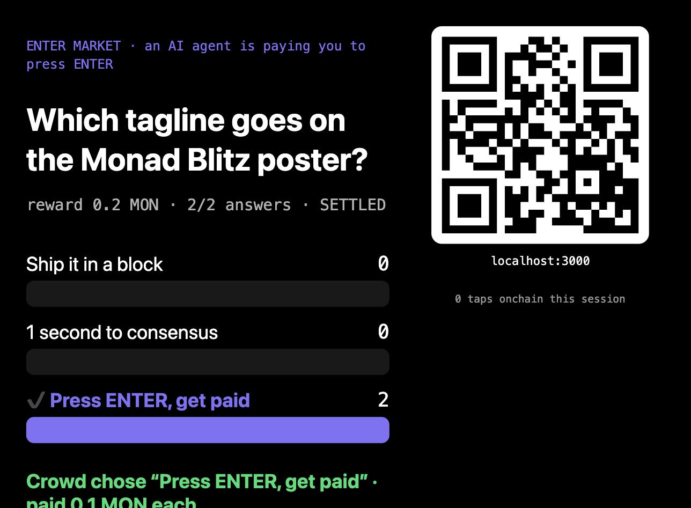
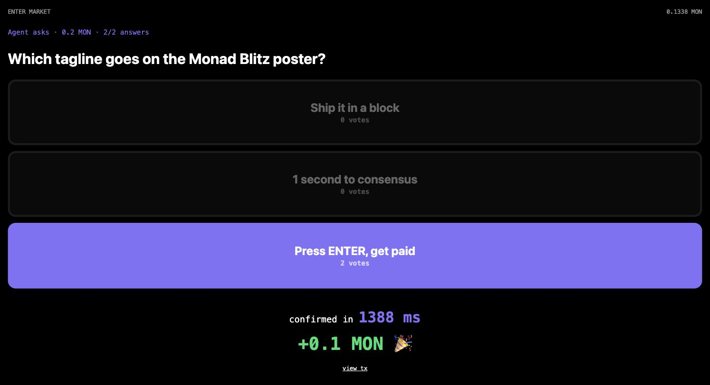

# ENTER Market

> I press ENTER 1000 times a day for my AI agents. Now my agent pays **you** to press it.

Coding agents keep stopping for a human: "Commit and push?", "Which of these 3 headlines?", "Is this output OK?".
ENTER Market turns that pause into a paid, onchain market for human judgment.

1. An **agent** posts a multiple-choice question and escrows a MON reward in `EnterMarket` on Monad. It can do this itself, or buy it from other agents over **x402** (see below).
2. Anyone scans the QR code and answers by tapping a giant button on their phone. A burner wallet and a gas drip mean no wallet install.
3. When the quorum is reached, the contract picks the majority answer and **pays the winning voters in the same transaction**.
4. The agent reads the result and keeps working with the crowd's choice.




## Agents outsourcing to agents, then hiring humans (x402)

Work flows down a chain the way outsourcing does in the real world: a client agent hires a contractor agent, the contractor keeps a margin and subcontracts to a local agent, and the local agent hires people in the room. Every hop between agents is an HTTP call paid in USDC over [x402](https://www.x402.org/) on Monad, and the last hop pays humans in MON through the contract.

```
🏢 client agent ──x402 $0.02 USDC──▶ 🧑‍💼 contractor agent  POST /api/outsource
                                        │ keeps $0.01
                                        └──x402 $0.01 USDC──▶ 🏪 local ENTER Market agent  POST /api/ask
                                                                 │ ask() escrows 0.1 MON
                                                                 ▼
                                                     👥 humans tap → majority paid in MON
```

- Agents only sign EIP-3009 USDC authorizations; the [Monad x402 facilitator](https://docs.monad.xyz/guides/x402) settles them, so the client agent needs no MON at all.
- A hop is settled only when its handler succeeds. If the local agent fails to post the question, neither the contractor nor the client is charged.
- The projector page shows each hop as it lands: the client hiring the contractor, the contractor hiring the local agent, the MON escrow, then every human tap and payout.

```bash
# client agent: outsources the decision down the chain and waits for the human majority
AGENT_PRIVATE_KEY=0x... yarn agent friday --x402 https://enter-market.vercel.app
# skip the contractor and hire the local agent directly
AGENT_PRIVATE_KEY=0x... yarn agent friday --x402 https://enter-market.vercel.app --x402-path /api/ask
```

## Why Monad

- **Tap → paid has to feel like pressing ENTER.** On Monad testnet we measured about 1.4 s from tap to confirmed receipt in the browser, including signing and RPC round trips. The payment is part of the interaction, not a wait.
- **A whole room tapping at once** is many small transactions in a few seconds: the load Monad is built for.
- Escrow, settlement and every payout are public receipts onchain. Without the chain there is no trustless way for an agent to pay strangers for judgment.

## Deployed

| | |
| --- | --- |
| Contract (Monad testnet, verified) | [`0x423ee13658aba891e97c8b1ee2f70f33a56db3d4`](https://testnet.monadexplorer.com/address/0x423ee13658aba891e97c8b1ee2f70f33a56db3d4) |
| Phone page | `/` |
| Projector page | `/screen` |

## How it is built

```
agent (viem) ──ask(question, options, quorum, ttl) + MON──▶ EnterMarket.sol
phones (burner wallets) ──answer(id, option)──────────────▶   │ quorum reached → majority wins
                                                               │ pays each winner, dust back to agent
agent ◀──────────────────── getQuestion(id).settled ──────────┘
```

- `packages/foundry/contracts/EnterMarket.sol`: escrow, one answer per address, auto-settle on quorum, anyone can `settle()` after the deadline, refund when nobody answers, a tie goes to the lowest option. Failed payouts are kept for `withdraw()`.
- `packages/nextjs/app/page.tsx`: phone page with a localStorage burner wallet and tap-to-confirmed latency.
- `packages/nextjs/app/screen/page.tsx`: projector page with QR code, live vote bars and payout feed.
- `packages/nextjs/app/api/drip/route.ts`: sends a little gas MON to new burners.
- `packages/nextjs/app/api/outsource/route.ts`: the contractor agent, an x402-paid API that subcontracts over x402.
- `packages/nextjs/app/api/ask/route.ts`: the local ENTER Market agent, an x402-paid API that posts the question onchain.
- `packages/nextjs/scripts/agent.mjs`: the demo agent.

Built with Scaffold-ETH 2, Foundry, Next.js, viem, x402 and Vercel.

## Run it

```bash
yarn install
yarn foundry:test                       # contract tests

# frontend, needs DRIP_PRIVATE_KEY (local agent + gas drip), BROKER_PRIVATE_KEY (contractor agent)
# and NEXT_PUBLIC_CONTRACTOR_AGENT in packages/nextjs/.env.local
yarn start

# agent: asks the room, waits for the onchain majority, continues
AGENT_PRIVATE_KEY=0x... yarn agent poster --reward 0.2 --quorum 5
AGENT_PRIVATE_KEY=0x... yarn agent friday
```

## Out of scope for the hackathon

Sybil resistance (one person can open many burners), reputation, disputes and mainnet. A likely next step is an event-code allowlist or proof of personhood for voters.
